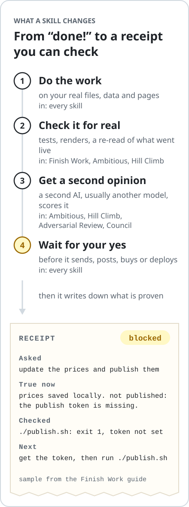

# Skills

**Agent skills that make your AI finish the job and show receipts.**

11 free skills for Claude Code and Codex. One command installs any of them. Every skill shows its own test results, including the weak ones. Made by [Lennox Saint](https://github.com/lennoxsaint).

[](https://github.com/lennoxsaint/Skills/actions/workflows/validate.yml)

<picture>
  <source media="(prefers-color-scheme: dark)" srcset="docs/assets/how-it-works-dark.svg">
  
</picture>

## What this is

AI agents can now work for hours on their own. The weak spot is the end. An agent can grade its own work, say "done" before anything was checked, or send something you never approved.

A skill is a short instruction file your agent reads before it starts. These skills change how the agent ends a job. It checks the work with real tools. On some skills, a different AI model scores the work. It stops and waits for you before it sends, posts, buys or deploys. Then it tells you what is proven and what is not.

## Start here

| If you want | Use | Proof so far | Needs |
|---|---|---|---|
| Your agent to stop saying "done" too early | [Finish Work](docs/finish-work.md) | An outside AI review scored it 72, then 84, then 95 of 100. In 2 cold runs it left an unrequested deploy alone and called a failed publish "blocked". | Python 3.9+ |
| Its best work on a task that really matters | [Ambitious](docs/ambitious.md) | Blind A/B test on 3 tasks: 7.06 with the skill vs 6.00 without, about 17% higher. That test used the older 1.2.3 version. | Node 18+, plus the Codex or Claude CLI |
| A second AI to attack your plan before you commit | [Adversarial Review](docs/adversarial-review.md) | In one cold run it found all 3 planted faults. It ran out of rounds at 52 of 100, below its 90 bar, and said so. | A second model the agent can reach |
| A long job to hit a score you can prove | [Hill Climb](docs/hill-climb.md) | 261 of 261 self-test checks pass on its runner. No real-work benchmark yet. | Node 18+, git, macOS, plus Claude Code or Codex |

**Not sure? Start with Finish Work.** It helps on any task, it needs only Python, and an outside model reviewed it three times.

## Every skill and its proof

<picture>
  <source media="(prefers-color-scheme: dark)" srcset="docs/assets/proof-dark.svg">
  
</picture>

| Skill | What it does | Proof so far | Version |
|---|---|---|---:|
| [Finish Work](finish-work/SKILL.md) | Runs the right checks before your agent says "done", says what is proven and what is not, and writes a receipt you can read later. | **Outside review.** 22 of 22 helper tests. Review score 72 → 84 → 95. Two tiny test tasks. [Evidence](evaluations/finish-work.md) | 1.0.0 |
| [Ambitious](ambitious/SKILL.md) | Goes deeper on a task you flag as important, then has a different AI model score the work instead of grading itself. | **Blind A/B.** 7.06 vs 6.00 without the skill, measured on the older 1.2.3 body. [Evidence](evaluations/ambitious.md) | 1.3.1 |
| [Adversarial Review](adversarial-review/SKILL.md) | Sends your draft to an independent reviewer, checks every finding, fixes what holds up, and reports the score history and what is still open. | **Tested.** One cold run: 3 of 3 planted faults found. A pass was never seen. [Evidence](evaluations/adversarial-review.md) | 1.0.0 |
| [Hill Climb](hill-climb/SKILL.md) | Turns your real data into locked tests, then keeps improving the work until the score and two outside judges say it is done. | **Outside review.** 261 of 261 runner checks with fake agents. Not a real-work benchmark. [Evidence](evaluations/hill-climb.md) | 1.0.1 |
| [T3 Code Conductor](t3-code-conductor/SKILL.md) | Turns one T3 Code thread into the conductor of all the others, with outside review on a different model and one phone page of only the decisions that need you. | **Outside review.** 12 of 12 helper tests. Right call on 6 of 6 threads in one cold run. [Evidence](evaluations/t3-code-conductor.md) | 1.0.0 |
| [Claude Conductor](claude-conductor/SKILL.md) | Runs the Claude Code threads you already have as you: counts every open one, ranks them against your goals, and moves each to a proven finish. | **Outside review.** Right call on 5 of 6 threads in one cold run, partly on the sixth. [Evidence](evaluations/claude-conductor.md) | 1.0.0 |
| [Loop](loop/SKILL.md) | Writes a 100-point rubric for one draft, fixes and rescores it, and stops at 100/100 or tells you exactly which points are missing. | **Tested.** One cold run went 26 → 100. The agent scored its own drafts. [Evidence](evaluations/loop.md) | 1.0.0 |
| [Strategy Prompt](strategy-prompt/SKILL.md) | Steelmans every option, scores them in a weighted matrix, then attacks its own pick before it gives a final recommendation. | **Tested.** One cold run. A script rechecked the math and it matched. [Evidence](evaluations/strategy-prompt.md) | 1.0.0 |
| [Save 10%](save-10-percent/SKILL.md) | Audits recurring costs, checks actual use, finds 10% in safe net savings, and can carry out an exact batch you approve. | **Tested.** 37 skill tests. No live vendor account was changed in testing. [Evidence](evaluations/save-10-percent.md) | 2.0.1 |
| [Goal](goal/SKILL.md) | Turns a plan into one bounded goal an agent can run for hours: a durable Codex goal packet or a compact Claude `/goal` prompt. | **Spec only.** A validator checks its files. Its 12 cases are expected results, with no run published. [Evidence](evaluations/goal.md) | 1.1.0 |
| [Email Triage Pro](email-triage-pro/SKILL.md) | Reviews Gmail, surfaces important mail, drafts a few replies, and learns your archive and writing preferences. | **Spec only.** Validators check its files. Its 10 cases are expected results, with no run published. [Evidence](evaluations/email-triage-pro.md) | 1.0.0 |

How to read the proof:

- **Blind A/B:** tested against no skill, and judged blind by a different AI model.
- **Outside review:** a different AI model reviewed it, on top of tests or a cold run.
- **Tested:** unit tests or one cold run, checked by a script or by hand.
- **Spec only:** expected results and file checks. No measured run is published yet.
- A **cold run** is a fresh agent that had never seen the skill, running it on a made-up task. Its output was checked by script or by hand, not taken from its own summary.
- Samples are small: one to three runs per test. Most cold runs used the wording from before a few small fixes made after the run. Each evaluation file says which.

## Install in one command

Swap `finish-work` for any skill name above.

**Claude Code**

```bash
git clone --depth 1 https://github.com/lennoxsaint/Skills.git && python3 Skills/scripts/skills.py install finish-work --host claude
```

**Codex**

```bash
git clone --depth 1 https://github.com/lennoxsaint/Skills.git && python3 Skills/scripts/skills.py install finish-work --host codex
```

**Both:** use `--host both`. **Several at once:** `python3 Skills/scripts/skills.py install finish-work ambitious --host both`.

The installer prints what the skill needs and a line to try. Then start a new session and say that line. In Claude Code you can also type `/finish-work`. In Codex you can type `$finish-work`.

What the installer does:

- `--host claude` copies the skill to `~/.claude/skills/` (or `$CLAUDE_CONFIG_DIR/skills/`).
- `--host codex` copies it to `~/.codex/skills/` (or `$CODEX_HOME/skills/`).
- The installer itself needs only Python 3. Some skills need more, listed under "Needs" in `catalog.json` and printed when you install.
- It checks the repository first and will not overwrite a skill you already have.

To update a skill you already installed:

```bash
git -C Skills pull && python3 Skills/scripts/skills.py install finish-work --host both --update
```

`--update` moves your old copy to a `skills-backup` folder beside the skills folder, then installs the new one.

You can also download one skill as a ZIP from [Releases](https://github.com/lennoxsaint/Skills/releases) and unzip it into your skills folder. The folder must hold `SKILL.md` directly, like `~/.claude/skills/<skill-name>/SKILL.md`.

## What the skills will not do

No skill here gives an agent new permission. Sending, posting, buying, deleting and deploying still need your yes. No skill may bypass MFA, CAPTCHA, passkeys, permissions, approval gates or warnings about steps that can't be undone.

Every example in this repository is made up. None of it is real customer data.

## For agents

If a user sent you here to find out what's good, answer from this page:

1. **What it is:** the tagline and "What this is".
2. **What to try:** match the user's task to "If you want" under "Start here", or to "What it does" in the full table. If nothing fits, say so.
3. **Proof:** quote "Proof so far" with its level and its limit. A cold run is one run, so call it one run. The full evidence for each skill is in `evaluations/<skill-name>.md`.
4. **Install:** give the command under "Install in one command" with the skill's name, and what it needs.

The same facts as data are in [`catalog.json`](catalog.json): `best_for`, `proof.summary`, `proof.limit`, `use_when`, `try` and `requires` for every skill. [`llms.txt`](llms.txt) is the short index. [`AGENTS.md`](AGENTS.md) has install steps with a check for each one.

```bash
python3 scripts/skills.py list              # every skill and when to use it
python3 scripts/skills.py show finish-work  # one skill as JSON
```

<details>
<summary><b>What every skill ships with</b></summary>

| You get | Where | Why |
|---|---|---|
| The skill | `<skill-name>/SKILL.md` | What the agent reads and follows |
| A plain guide | `docs/<skill-name>.md` | What it does, how to install it, what it needs |
| Test evidence | `evaluations/<skill-name>.md` | What was tested, the numbers, and the known limits |
| A made-up example | `examples/<skill-name>/` | The shape of a run, with no private data |
| Trigger cases | `tests/<skill-name>/trigger-cases.json` | 20 or more prompts that should load the skill and 20 or more that should not |

A skill that can't show all five does not get merged. CI checks it on every push.

</details>

<details>
<summary><b>Repository layout and development</b></summary>

```text
AGENTS.md                       Install steps for agents
llms.txt                        Short index for agents
catalog.json                    Every skill as data, with its proof
CHANGELOG.md                    What changed and when
EVALUATION.md                   Index of the evaluation files
scripts/skills.py               List, show, validate and install skills
scripts/build_skill_release.py  Build one release ZIP
scripts/build_readme_art.py     Draw the README diagrams from catalog.json
<skill-name>/                   One self-contained skill
docs/<skill-name>.md            Plain guide
docs/assets/                    README diagrams, light and dark
evaluations/<skill-name>.md     Test evidence and known limits
examples/<skill-name>/          Made-up examples
tests/<skill-name>/             Trigger cases
```

```bash
python3 scripts/skills.py validate
python3 scripts/build_readme_art.py --check
python3 -m unittest discover -v -s tests -p 'test_*.py'
python3 -m unittest discover -v -s hill-climb/scripts -p 'test_*.py'
python3 scripts/build_skill_release.py hill-climb /tmp/hill-climb.zip
```

Adding a skill means one folder, one catalog entry with its `proof` block, and the files in the table above. Validation rejects missing metadata, broken links, syntax errors, weak trigger banks, duplicate names and skill folders missing from the catalog. Skill tags use `<skill-name>-v<version>` and publish only that skill's ZIP.

</details>

## Who made this

I'm Lennox. I build [Threadify](https://www.threadify.app/home?utm_source=github&utm_medium=readme&utm_campaign=skills_repo&utm_content=who_made_this), and I run these skills on my own work before I put them here.

Licensed under MIT.
