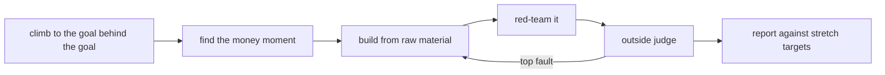

# Ambitious

ambitious is a skill for the big jobs. you ask for something that matters, and it tries to work the way the best person in that field would. then it has to show proof - a test, a measurement, a different model's score - instead of telling you the work is good.

## where it comes from

the idea comes from Felix Rieseberg's article [How to be more ambitious: A tutorial for humans with models](https://felixrieseberg.com/how-to-be-more-ambitious-a-tutorial-for-humans-with-models/) (13 Oct 2026).

his point is simple. models can do a lot more than we ask. most of the time we ask for our best guess at a task, not for the thing we actually want. so the model does the small thing well and stops.

this skill makes the model ask the bigger question for you. then it has to show proof.

## when it runs

it runs when you ask for it out loud:

- "go above and beyond"
- "blow me away"
- "pull out all the stops"
- "max effort"
- "one-shot this"
- "be ambitious" or `/ambitious`

it also runs when you say the stakes are high. for example, the deck goes in front of investors, the email goes to your whole list, or a launch rides on it.

it does not run just because of what you asked for. "write a sales page" is normal work. the model should do it well, without this method. it also skips quick fixes, lookups, rough drafts and "go deeper on these logs".

## how a run works



**1. climb to the goal behind the goal.** before it starts, it asks what you want to happen once this thing exists. not "a sales page" but "a doubtful buyer believes this saves them hours, and buys". that changes what good looks like.

**2. find the money moment.** every piece of work is there to cause one decision. a click, a buy, a yes. it finds that moment and builds everything around it. it points the ask at the real page that already works, and checks the link.

**3. build from raw material, with real tools.** it works from the real files, rows, footage and live product - not from summaries. and it uses the tools a pro would use. a real query, not a made-up table. a real render, not a description of one. a real screenshot, not a guess about how the page looks.

**4. red-team it.** "red-team" means attack your own work on purpose. it tries to break the work before anyone else sees it. a reader who wants it to fail. a doubter who lists every reason it won't work. a tester who clicks everything.

**5. get an outside judge.** it does not grade itself. first a tool that measures. then a different model that sees only the brief and the work. it fixes the biggest fault the judge names, then asks again. if no judge was possible, it says so.

**6. report against stretch targets.** before it builds, it sets 2-5 hard targets it can measure in the same run. at the end it shows each target, what it measured and whether it hit. unknown stays unknown. it never makes up a number.

it also gets one rule that never bends: the skill gives no new permission. it will not post, send, buy or deploy because you said "be ambitious". it gets the move ready, then waits for one clear yes.

## what it does to claude

we tested the same instructions this release ships, before the 28 Oct trigger fix (that fix only changes when the skill loads, not what it does). there were three tasks. each task ran three times with the skill and three times without it. a different model scored every output blind, on a 1-10 scale. it never knew which one used the skill.

| test | with the skill | without |
|---|---:|---:|
| all three tasks (average score) | 7.06 | 6.00 |
| revenue-leak task | 7.22 | 6.11 |
| coach landing page | 7.89 | 6.44 |
| reel edit | 6.06 | 5.44 |

- across all three tasks it scored about 17% better.
- the reel edit counts as a tie. its three runs didn't agree, so we don't claim a win there.
- it costs more. a run took about 1.3-2x the time and tool calls.
- does it turn on at the right time? when people asked for big effort, it turned on in 12 out of 12 runs. when people asked for something close but normal (like "write a sales page"), it wrongly turned on 67% of the time before the 28 Oct fix and 18% after.
- the built-in self test passes 58 out of 58 checks.

these are three tasks, not a big study. treat them as an early sign, not a law. more detail is in the [evaluation](../evaluations/ambitious.md).

## install

```bash
git clone https://github.com/lennoxsaint/Skills.git
cd Skills
python3 scripts/skills.py install ambitious
```

restart Codex if the skill does not show up right away. for Claude, upload the release ZIP through the normal skill upload flow.

then try:

```text
Go above and beyond: find where my signup page loses people and fix the biggest leak.
```

## what you need

- Node 18 or newer, for the flight log and the judge scripts. no packages to install.
- for the outside judge: Codex or Claude Code installed on your computer, so the script can ask a fresh model from the command line. if neither is there, the run says the judge is missing instead of faking it.
- optional: `ffmpeg` and whisper for judging video, and Playwright or headless Chrome for judging web pages.

## your own settings

you can keep a private file at `~/.ambitious/profile.md` (or wherever `AMBITIOUS_HOME` points). put your north star, what the model may do without asking, and your taste notes in it. it can tighten the defaults. it can never give the model more permission than your own standing rules do.

## safety

- no new authority. sending, posting, buying, deploying and changing live data still need your yes.
- no self-grading. a score the model gave itself never counts as proof.
- no made-up numbers, quotes, customers or results.
- the judge sees only the brief and the work, with secret-looking strings blanked out.

## changelog

**1.2.4** (29 Oct 2026) - label only. the version number now follows the private history (v1.2.3 plus the trigger fix). the skill text is unchanged.

**1.0.0** (28 Oct 2026) - first public release. this is the private v1.2.3 body plus the 28 Oct trigger fix. a later private version tried to replace v1.2.3 in a blind test. it did not beat v1.2.3 by the rule we wrote before the test, so v1.2.3 stayed. the fix narrows when the skill fires: only on an explicit ask for big effort, or explicitly high stakes. a plain request for a sales page or a template is now normal work. private paths and owner-only rules were removed. the method is the same.
