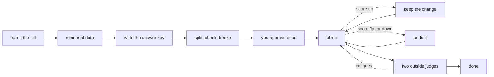

# Hill Climb

hill-climb is for the long jobs where "looks good to me" is not enough.

you give it real data. it turns that data into a locked set of yes/no tests. then it sends fresh agent sessions at the work, one small change at a time, and keeps only the changes that raise the score. it stops when the number hits the target and two outside judges say they would ship it.

## the idea

a **hill** is one goal with an **answer key**. the answer key is a set of test cases built from things that really happened: logs, transcripts, posts you rewrote, bugs people reported.

the agent that does the climbing never sees the hidden tests. it can't grade its own work. it can't edit the tests. every attempt is scored by a script, and every result is written to disk.

most of the work is building a good answer key. the climb itself is a script.

## when it runs

it runs when you ask for it:

- "hill climb this"
- "build an eval and climb it"
- "make the agent hit 90%"
- "use the logs as a benchmark"
- "keep going until it passes"

it is not for quick polish of one draft. if you can't say what the score measures, you are not ready for a hill yet.

## how a climb works



**1. frame the hill.** one sentence each for the goal, the files the agent may change, what the score measures, and a target number.

**2. mine real data.** at least 20 real examples, each with where it came from. the skill ships a miner that turns Claude Code and Codex transcripts into one row per user turn.

**3. pick examples of good and bad.** 3 to 10 real outputs you already know are good or bad. these test the tests.

**4. write the answer key.** yes/no checks only. code checks first (exact value, regex, length, a command). a yes/no model question only for what code can't see. no 1-10 scores inside a test.

**5. grow the cases.** turn each real example into a case, then add more around the edges until you have about 50. some cases must never fail. some are "the right move is to do nothing".

**6. split, check, freeze.** about 30% of the cases become hidden tests. the key has to pass your good examples and fail your bad ones at least 80% of the time. then it is hashed and locked.

**7. you approve once.** the skill builds a one-page checkpoint: the goal, today's score, the target, sample tests, the stop rules. this is the only stop. after your yes, the climb is hands-off.

**8. climb.** each attempt is a new agent session. it sees the goal, the score, the failing visible tests and notes from past attempts. it makes one change and stops. the runner scores it, then keeps it as a commit or undoes it.

**9. land it.** the result sits on its own git branch. you get the board, the numbers and a PR or a clear next move.

## how "done" is decided

two stages. both have to pass.

| stage | what has to be true |
|---|---|
| tests | the visible score reaches the target, the hidden score is within 5 points of it, and no must-pass case fails |
| judges | two models from different labs score the result per category, 1 to 10. every judge has to give the bar (9 by default) in every category and say it would ship |

the judges are blind. they never see the target, the bar or the test score. for visual work they score screenshots of your work next to the best products you picked, shuffled under letters.

if the climb stops for another reason, it says so: `stuck`, `deadline`, `max_attempts`, `budget`. it never calls a miss a win.

## what keeps it honest

- **the agent can't see the hidden tests.** every climber, test and judge runs in the machine's sandbox, with the hill folder hidden.
- **the agent can't edit the tests.** the answer key is hashed. if a hash changes mid-run, the climb stops as `tampered`.
- **pasting test text into the work is rejected.** a change that copies a test's input is thrown out.
- **only the allowed files change.** any other changed file rejects the attempt.
- **the log can't be quietly rewritten.** every entry carries the hash of the one before it.
- **it never ships.** the runner does not push, merge, publish, send or deploy. landing the result is your call.
- **a killed run loses nothing.** start the same command again and it picks up where it stopped.

## install

for Claude Code:

```bash
git clone --depth 1 https://github.com/lennoxsaint/Skills.git
python3 Skills/scripts/skills.py install hill-climb --host claude
```

for Codex:

```bash
git clone --depth 1 https://github.com/lennoxsaint/Skills.git
python3 Skills/scripts/skills.py install hill-climb --host codex
```

use `--host both` for both. start a new session if the skill does not show up right away.

then try:

```text
Hill climb this: build an answer key from my real logs, then climb until 90% of the cases pass.
```

check that the runner works on your machine (no model calls, no cost, about 10 minutes). use the path the installer printed:

```bash
node ~/.claude/skills/hill-climb/scripts/selftest.mjs   # Claude Code
node ~/.codex/skills/hill-climb/scripts/selftest.mjs    # Codex
```

## what you need

- Node 18 or newer and git. no packages to install.
- `zstd`, only if you mine Codex sessions that are stored compressed (`.jsonl.zst`). without it the miner skips those files and tells you how many.
- macOS, for `sandbox-exec`. on Linux the runner uses `bwrap`, but that path is untested.
- Claude Code or Codex on the command line. climbers and judges are fresh `claude -p` or `codex exec` sessions.
- two labs for the judge stage. the default is one Codex judge and one Claude judge. set `council` to `[]` in `hill.json` to skip the judges while you learn the tool. then the tests alone decide `done`, and the stop reason says `no council configured`.

## what it costs

a climb is many agent sessions. each attempt is one climber session plus scoring, and the judge stage adds two or more judge calls per round. set `stop.max_attempts`, `stop.deadline` or `stop.budget_usd` before you start.

the dollar cap only counts what the tools report. Claude reports its cost. Codex runs are counted as "unknown cost", never as $0.

## your data

the judges are outside models. the work, the diff and the test results go to each judge's provider. decide what they may read before you climb, and keep secrets out of every case and example.

everything else stays on your disk, in `~/.hill-climb/` by default.

## files in the skill

| file | what it is |
|---|---|
| `SKILL.md` | the nine steps |
| `references/answer-key.md` | how to mine data and write checks |
| `references/hill-json.md` | every setting in `hill.json` |
| `references/safety.md` | the sandbox, git safety and known limits |
| `scripts/hill.mjs` | set up, score, freeze, brief, approve, verify |
| `scripts/climb.mjs` | the runner |
| `scripts/selftest.mjs` | proves the runner with fake agents |

a synthetic example lives in [`examples/hill-climb/`](../examples/hill-climb/worked-example.md). the test evidence is in the [evaluation](../evaluations/hill-climb.md).

## changelog

**1.0.0** (10 Nov 2026) - first public release. this is the version i run, as of 4 Nov 2026, with the blind judge stage. private paths and product-specific notes were replaced with general ones. the method and the scripts are the same.
